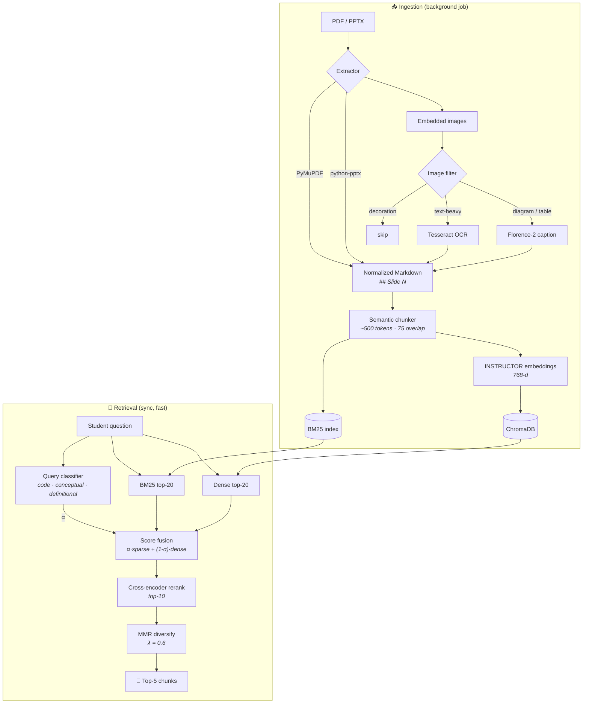

<div align="center">

# 🎓 Tutor RAG

### Upload your lecture slides and ask them questions

*A retrieval engine for course material. It reads PDFs and PowerPoints (including the diagrams), splits them into slide-aware chunks, and finds the right passage for a student's question with hybrid search, cross-encoder reranking and diversity filtering.*


[Why](#-why-this-exists) •
[How it works](#-how-it-works) •
[Quick start](#-quick-start) •
[API](#-http-api) •
[Retrieval](#-the-retrieval-pipeline) •
[Ingestion](#-the-ingestion-pipeline)

</div>

---

## 🤔 Why this exists

Lecture slides are hard to search. Half the meaning is in diagrams, bullet points are fragments, and code snippets confuse ordinary semantic search. Ask a basic RAG system *"what does `nn.Embedding` return?"* and it often hands you a vaguely related slide about neural networks.

**Tutor RAG is built for this kind of material:**

- 🖼️ It **reads images.** Tesseract OCRs text-heavy figures and Florence-2 captions diagrams, so a flowchart becomes searchable text.
- 📑 It **respects slide boundaries.** Each chunk knows which slides it came from (`slide_range: "5-8"`).
- 🔀 It **adjusts its search to the question.** Code questions lean on keyword matching and conceptual questions lean on meaning.
- 🎯 It **reranks and diversifies results,** so the top 5 are relevant and don't repeat each other.

It runs as a standalone **FastAPI microservice** that a larger tutoring app calls over HTTP.

---

## 🧭 How it works



---

## 🚀 Quick start

### Prerequisites

- Python 3.10+
- [Tesseract OCR](https://github.com/tesseract-ocr/tesseract) installed (`brew install tesseract` / `apt install tesseract-ocr`)
- About 2 GB of disk for model downloads (fetched automatically on first use)

### Install

```bash
git clone https://github.com/CapCoder0/tutor-rag.git
cd tutor-rag

python -m venv .venv && source .venv/bin/activate
pip install -r requirements.txt

cp .env.example .env    # set TESSERACT_CMD if tesseract isn't on your PATH
```

### Option A: use it from the command line

```bash
# Ingest lectures into a course collection
python src/pipeline.py lectures/L1.pdf lectures/L2.pptx --collection nlp_course
```

### Option B: run the microservice

```bash
export RAG_API_TOKEN="pick-a-long-random-string"   # leave unset to disable auth locally
uvicorn service.main:app --host 0.0.0.0 --port 8000 --reload
```

Interactive docs: **http://localhost:8000/docs**

---

## 📡 HTTP API

Every endpoint except `/health` expects the header `X-Internal-Token: $RAG_API_TOKEN`.

| Method | Endpoint | What it does |
|---|---|---|
| `GET` | `/health` | Liveness check |
| `POST` | `/ingest` | Start ingesting files in the background. Returns a `job_id` immediately |
| `GET` | `/ingest/{job_id}` | Poll the job: `queued` → `running` → `done` / `failed` |
| `POST` | `/retrieve` | Get the best chunks for a question (synchronous) |
| `DELETE` | `/collections/{collection}` | Delete a course collection and its BM25 index |

### 1️⃣ Ingest a lecture

```bash
curl -X POST http://localhost:8000/ingest \
  -H "X-Internal-Token: $RAG_API_TOKEN" -H "Content-Type: application/json" \
  -d '{
        "files": ["uploads/Lecture_2_NLP.pdf"],
        "collection": "nlp_course",
        "lecture_num": 2,
        "lecture_title": "Word Embeddings",
        "use_florence": true
      }'
# → {"job_id": "3f2c...", "status": "queued"}
```

### 2️⃣ Wait for it

```bash
curl http://localhost:8000/ingest/3f2c... -H "X-Internal-Token: $RAG_API_TOKEN"
# → {"status": "done", "summary": {...chunks added...}}
```

### 3️⃣ Ask a question

```bash
curl -X POST http://localhost:8000/retrieve \
  -H "X-Internal-Token: $RAG_API_TOKEN" -H "Content-Type: application/json" \
  -d '{"query": "How does word2vec skip-gram work?", "collection": "nlp_course", "top_k": 5}'
```

```json
{
  "query": "How does word2vec skip-gram work?",
  "collection": "nlp_course",
  "results": [
    {
      "chunk_id": "Lecture_2_NLP_chunk_7",
      "text": "## Slide 14\n### Skip-gram\nPredict surrounding context words from the centre word...",
      "metadata": { "source": "Lecture_2_NLP.md", "slide_range": "14-17", "topic": "Skip-gram", "tokens": 486 },
      "rerank_score": 8.21,
      "fused_score": 0.74
    }
  ]
}
```

<sub>Illustrative response. Pass <code>lecture_num</code> to limit results to one lecture.</sub>

---

## 🎯 The retrieval pipeline

Five stages, each fixing a weakness of the one before it:

| # | Stage | Why it's there |
|---|---|---|
| 1 | **Query classification** | Picks the keyword-vs-semantic weight α from the question type |
| 2 | **Hybrid search** | BM25 catches exact terms like `softmax` or `nn.LSTM`. Dense search catches paraphrases. Each returns its top 20 |
| 3 | **Score fusion** | `final = α · sparse + (1 − α) · dense` |
| 4 | **Cross-encoder rerank** | Scores the query and each chunk *together*, which catches details the bi-encoder misses. Keeps the top 10 |
| 5 | **MMR** | `λ · relevance − (1 − λ) · redundancy` with λ = 0.6. Removes near-duplicate chunks and returns the top 5 |

### Adaptive fusion: α depends on the question

| Query type | Example | α (BM25 weight) | Leans toward |
|---|---|---|---|
| 💻 **Code / syntax** | *"what does `torch.no_grad()` do"* | **0.6** | keyword precision |
| 📖 **Definitional** | *"what is perplexity"* | **0.5** | balanced |
| 💡 **Conceptual** | *"why does attention help long sentences"* | **0.4** | semantic meaning |

### Models

| Role | Model | Size |
|---|---|---|
| Dense embeddings | [`hkunlp/instructor-base`](https://huggingface.co/hkunlp/instructor-base): instruction-aware, 768-d | ~440 MB |
| Reranker | [`cross-encoder/ms-marco-MiniLM-L-6-v2`](https://huggingface.co/cross-encoder/ms-marco-MiniLM-L-6-v2) | ~80 MB |
| Diagram captioning | [`microsoft/Florence-2-base`](https://huggingface.co/microsoft/Florence-2-base) | ~460 MB |
| OCR | Tesseract | system install |

All models load **lazily**, so nothing downloads until it's first needed.

---

## 📥 The ingestion pipeline

### 1. Extraction: slides become Markdown

- **PDF** (PyMuPDF): one page per slide (`## Slide N`), headings found from font size, bullets from leading symbols, paragraph boundaries inferred
- **PPTX** (python-pptx): keeps slide boundaries and title/body/bullet hierarchy, pulls out embedded images

### 2. Vision: images become text

A shared **image filter** decides what each image gets:

- 📝 **Text-heavy figures** → Tesseract (fast and accurate on printed text)
- 📊 **Diagrams, tables, photos** → Florence-2 captions
- 🎨 **Logos and decoration** → skipped
- Florence output that looks hallucinated is dropped before it reaches the index

Running Tesseract first and Florence only when needed keeps ingestion practical on a CPU.

### 3. Chunking: structure first

- Target **450–550 tokens** (about 3–4 slides), with **75 tokens of overlap**
- Splits at the most natural boundary available: **slide header → paragraph → sentence → word**
- Token counts use the embedding model's tokenizer, so chunks fit its 512-token window
- Each chunk keeps `chunk_id`, `source`, `slide_range`, `topic` and `tokens`

### 4. Indexing: two indexes, one collection

- **ChromaDB** (cosine space) stores embeddings and metadata on disk, with no server to run
- **BM25** index pickled next to it, rebuilt in milliseconds when chunks are added
- **One collection per course** (e.g. `nlp_course`), not one per lecture

Intermediate files are kept for debugging:

```
data/
├── processed/<stem>.md      # normalized markdown
├── chunks/<stem>.jsonl      # chunks
├── chroma/                  # vector store + BM25 indexes
└── uploads/                 # incoming files
```

---

## 📁 Project structure

```
tutor-rag/
├── service/                  # FastAPI microservice
│   ├── main.py               #   endpoints + auth
│   ├── models.py             #   Pydantic request/response schemas
│   └── jobs.py               #   in-memory background job tracker
├── src/                      # the RAG library
│   ├── pipeline.py           #   end-to-end ingest orchestrator (also a CLI)
│   ├── preprocessing/        #   PDF/PPTX extractors, image filter, Tesseract, Florence-2
│   ├── chunking/             #   semantic chunker + token counter
│   ├── embedding/            #   INSTRUCTOR embedder + Chroma vector store
│   └── retrieval/            #   BM25, query classifier, reranker, MMR, retriever
├── requirements.txt
└── .env.example
```

---

## 🔐 Security notes

- Set `RAG_API_TOKEN` in any shared or deployed environment. **If it's unset, auth is disabled.**
- The service is meant to sit behind your main app, not on the public internet.
- `data/` and `.env` are git-ignored.

## ⚖️ Known limitations

- The job tracker is in memory, so jobs in progress are lost on restart. In production, use Celery + Redis or similar.
- Florence-2 is slow on CPU. A GPU makes ingestion much faster, or set `use_florence: false` to skip it.
- The query classifier uses keyword rules. It's fast but simple.

## 🗺️ Roadmap

- [ ] Persistent job queue (Celery / RQ)
- [ ] Per-user data roots (`data/users/<user_id>/`)
- [ ] Retrieval evaluation set (recall@k, MRR)
- [ ] Learned query classifier
- [ ] Dockerfile with models pre-downloaded

<div align="center">

**Because "it's somewhere in the slides" shouldn't be the end of the conversation. 📚**

</div>
